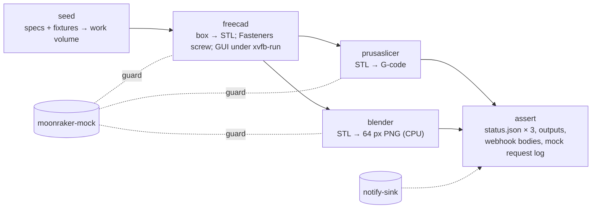

# gpu-batch-docker

Build repo for the **GPU batch lane** on the GTX 970 (`k8s-node-03`): fire-and-forget batch work whose completion is pushed, not polled ([homelab#1935](https://github.com/dvystrcil/homelab/issues/1935); design in [`homelab/architecture/gpu-batch-lane.md`](https://github.com/dvystrcil/homelab/blob/main/architecture/gpu-batch-lane.md)).

| Image | Contents |
|---|---|
| `harbor.sirddail.net/ai/gpu-batch-blender` | Ubuntu 26.04, Blender 5.2.2 LTS (official tarball, sha256-pinned), the `gpu_batch` runner, psql |
| `harbor.sirddail.net/ai/gpu-batch-freecad` | Ubuntu 26.04, FreeCAD 26.3rc2 (official AppImage, sha256-pinned, extracted), Fasteners workbench 0.5.64 (commit-pinned), `xvfb-run`, the `gpu_batch` runner, psql. CPU-only (max-01) |
| `harbor.sirddail.net/ai/gpu-batch-prusaslicer` | Ubuntu 26.04, PrusaSlicer 2.9.7 (Flathub build, app + GNOME 50 runtime pinned by ostree commit, run without flatpak), `rsvg-convert`, the `gpu_batch` runner, psql. CPU-only (max-01) |

Deployed by [`dvystrcil/gpu-batch`](https://github.com/dvystrcil/gpu-batch) (Job templates), submitted with `homelab/bin/gpu-batch-submit.py`.

## The runner contract

A job is a directory on the NFS work share. The runner (`python3 -m gpu_batch.runner <job>/spec.json`, the image entrypoint):

1. **Guard:** refuses to start while Neptune is printing (`src/gpu_batch/guard.py`). Moonraker first; Obico's `current_print_id` breaks the tie when the printer is unreachable. Every unknown fails closed. It re-checks every 60 s during a step and stops the step if a print starts.
   - **CPU-only templates** (FreeCAD, PrusaSlicer on max-01) set `GPU_BATCH_PRINT_GUARD=off` (exactly `off`). That skips the guard **only if the container cannot reach a GPU**: no `/dev/nvidia<N>` and no `NVIDIA_VISIBLE_DEVICES` naming one. If a GPU is visible, the switch is ignored and the reason says so, so setting it on a render does nothing. The guard protects the GTX 970's VRAM, and a job without a GPU can't touch it.
2. **Steps:** runs `spec.steps` in order, `{job}` expanded, each in its own process group with a timeout capped by the Job deadline minus 120 s. stdout goes to `job.log` and stderr to `job.err`.
3. **Proof:** success means `expect_outputs` exist, are non-empty, and are valid PNGs where `.png`, with at least `min_outputs` of them. Exit 0 alone is not success.
4. **Report:** writes `status.json` atomically at every transition, then POSTs it once to `GPU_BATCH_NOTIFY_URL` (the n8n receiver, which comments on GitHub).

| Exit | Meaning |
|---|---|
| 0 | succeeded, outputs verified |
| 1 | failed or aborted (step error, timeout, SIGKILL/OOM, missing outputs, bad spec) |
| 3 | refused by the print guard; no step ran |

Adding a workload: add a `FROM runner AS <name>` stage and a build step, plus a template in `gpu-batch`.

## Development

```bash
python3 -m pytest -q        # unit + composition tests, and the harness mocks (python 3.14 = the image)
```

### Testing the images

The shared compose harness ([#10](https://github.com/dvystrcil/gpu-batch-docker/issues/10)) runs the three tool images **chained**, the way a chain runs in the cluster, against a mock Moonraker and a stand-in for the n8n completion webhook.

```bash
for t in runner freecad prusaslicer blender; do docker build --target $t -t gpu-batch-$t:local .; done
bin/compose-test.sh                 # every case; or name some: bin/compose-test.sh chain printing
tests/compose/mutate.sh             # proves the harness goes red when it should (~10 min)
```



Every tool runs `python3 -m gpu_batch.runner /work/<tool>/spec.json`, exactly what the Job runs, with the completion webhook pointed at `notify-sink`. freecad and prusaslicer set `GPU_BATCH_PRINT_GUARD=off` (CPU-only) in every case, as their templates do.

| Case | Moonraker | Expect |
|---|---|---|
| `chain` | `standby` | all three `succeeded`, outputs valid (STL, G-code with PrusaSlicer's version and the box's 10 mm, 64×64 PNG), the tool versions, one webhook each, and blender's single guard probe |
| `printing` | `printing` | blender `refused` (no step ran); freecad and prusaslicer run |
| `print-starts` | `standby`, switched to `printing` once blender's step runs | blender `aborted` by the guard's 60 s mid-step re-check |
| `unreachable` | never answers | blender falls back to Obico (none in the harness) and refuses as unknown; the CPU-only tools run |
| `guard-ignored` | `printing` | blender with `GPU_BATCH_PRINT_GUARD=off` and `NVIDIA_VISIBLE_DEVICES=GPU-test` is still `refused`, and the reason says `ignored` |

The driver's last line is `COMPOSE-TEST-OK` only if every case's assert printed it as *its* last line. Images come from `FREECAD_IMAGE`, `PRUSASLICER_IMAGE`, `BLENDER_IMAGE` and `RUNNER_IMAGE` (default `gpu-batch-<name>:local`), so CI tests the images it just built. There are no bind mounts: on the ARC runners Docker is a DinD sidecar, so everything goes through the named volume `work`, which `seed` fills from the harness image.

Mock Moonraker modes (`tests/compose/mocks/`): any print state, `unreachable` (accepts, never answers: the guard's *no answer* → Obico path), `reset` (closes without a reply, which the guard treats as *reachable, state unknown*, not the Obico path) and `garbage`. Change it at runtime with `POST /_mock/state`, and read the probes from `GET /_mock/requests`.

**Adding a tool:**
1. A service in `tests/compose/compose.yaml` (`<<: *tool`, image from a `<TOOL>_IMAGE` variable, `command: [/work/<tool>/spec.json]`, plus `GPU_BATCH_PRINT_GUARD: "off"` if it is CPU-only), and `depends_on` on the step it consumes.
2. Its spec in `tests/compose/seed.py`, with any fixture script in `tests/compose/fixtures/`.
3. An assert block in `tests/compose/check.py` (`check_output`, plus its expected state in `CASES`), and a mutant in `mutate.sh` that breaks it.
4. The build target in `build.yaml`'s `compose-test` job, and the image env in `bin/compose-test.sh`.

Bumping Blender: change `BLENDER_VERSION` and `BLENDER_SHA256` together, both taken from `https://download.blender.org/release/Blender<major.minor>/blender-<ver>.sha256`.

Bumping FreeCAD: change `FREECAD_VERSION` and `FREECAD_SHA256` together. The checksum is the `digest` GitHub publishes for the `FreeCAD_<ver>-Linux-x86_64.AppImage` asset (`gh api repos/FreeCAD/FreeCAD/releases/tags/<ver> --jq '.assets[]|.name+" "+.digest'`); FreeCAD ships no separate checksum file. Fasteners: change `FASTENERS_REF` and `FASTENERS_COMMIT` together (the build fails if the fetched commit is not the pinned one). In GUI mode FreeCAD *imports* a `.py` argument as a module, so a script whose name shadows a loaded module (e.g. `gui.py`) never runs.

Bumping PrusaSlicer: Linux builds ship only through Flathub, so the `prusaslicer-fetch` stage installs `com.prusa3d.PrusaSlicer` with flatpak, pins it and its runtime to exact ostree commits (content hashes of the whole tree, so they are the integrity check), and the final stage copies just the files. Change `PRUSASLICER_VERSION`, `PRUSASLICER_COMMIT`, `GNOME_RUNTIME` and `GNOME_RUNTIME_COMMIT` together, from `flatpak info com.prusa3d.PrusaSlicer` and `flatpak info org.gnome.Platform//<branch>` on a machine running the version you want; the build fails if a commit or the version doesn't match. `prusa-slicer` runs on the runtime's own `ld-linux` and libraries, not through `flatpak run`: bwrap needs user namespaces, which a pod's seccomp profile refuses. Pass `--datadir` under the job dir, so nothing depends on HOME (the harness runs it with `HOME=/nonexistent`). A version bump also changes `EXPECT_PRUSASLICER` in `tests/compose/check.py` (and `EXPECT_FREECAD` for FreeCAD).

Licensed [MIT](LICENSE).
